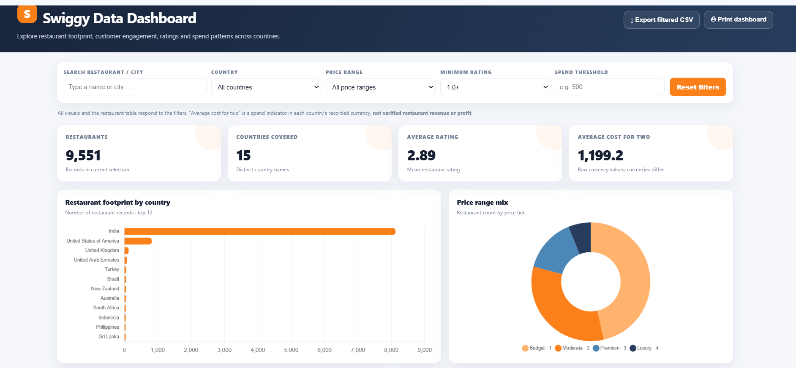
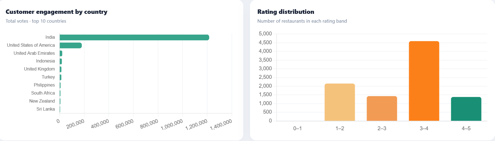
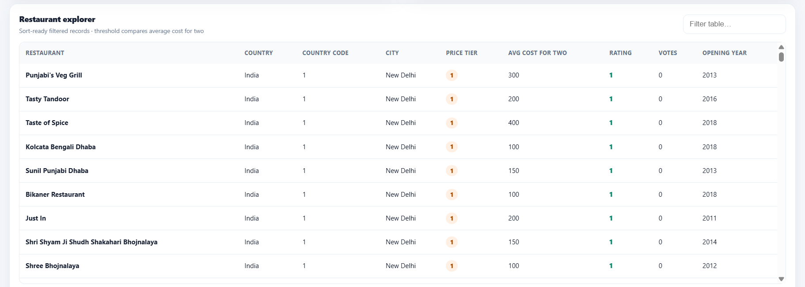

# Swiggy Restaurant Analytics Dashboard

An interactive, responsive dashboard for exploring restaurant data across countries.

## Dashboard Preview

### Main dashboard

### Customer engagement and rating analysis

### Restaurant explorer

## Features
- Restaurant count and country coverage KPIs
- Country-wise restaurant footprint
- Restaurant price-range distribution
- Customer engagement by country
- Restaurant rating distribution
- Search and filters for country, city, price range, rating, and spend threshold
- Filtered CSV export and print support
- Responsive desktop and mobile layout

## Technologies
HTML, CSS, JavaScript, and Chart.js.

## Run locally
Open `index.html` in a modern web browser.

## Live Demo
https://nalaya09.github.io/Swiggy-dashboard/

## Data note
Average cost for two is a spend indicator in the source data, not verified restaurant revenue or profit. Currency values may differ by country and are not normalized.
